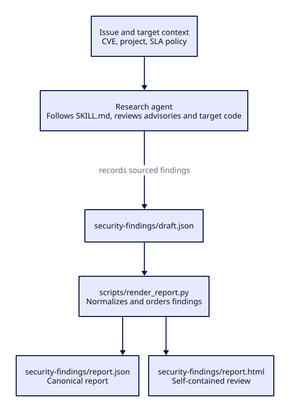

# Secdepth

Secdepth guides an agent through advisory review and target-code analysis, then renders evidence-backed findings.

*The agent records sourced findings in a draft; the renderer creates the canonical JSON report and a self-contained HTML review.*

[Diagram source](docs/diagrams/secdepth-flow.d2) · [PNG preview](docs/diagrams/secdepth-flow.png)
