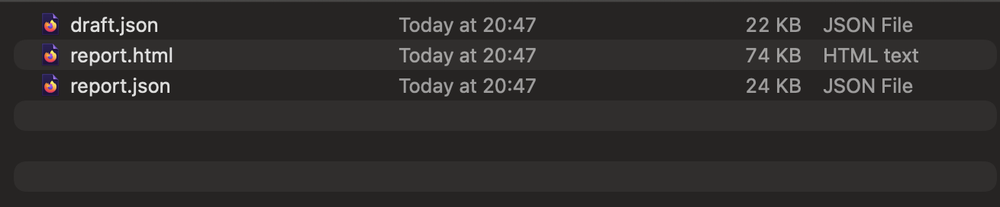
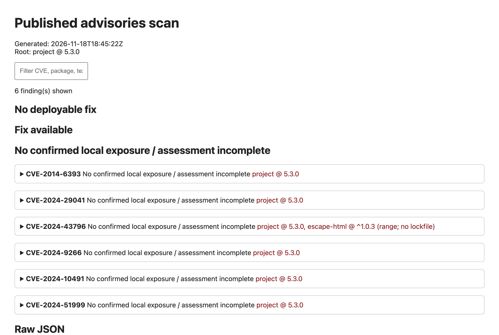
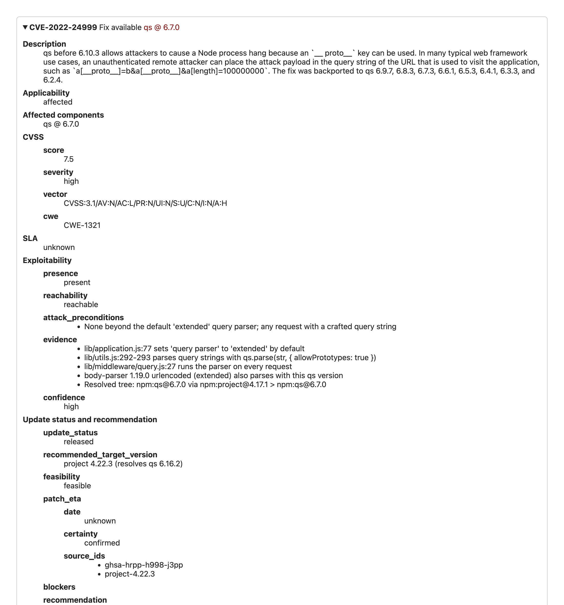
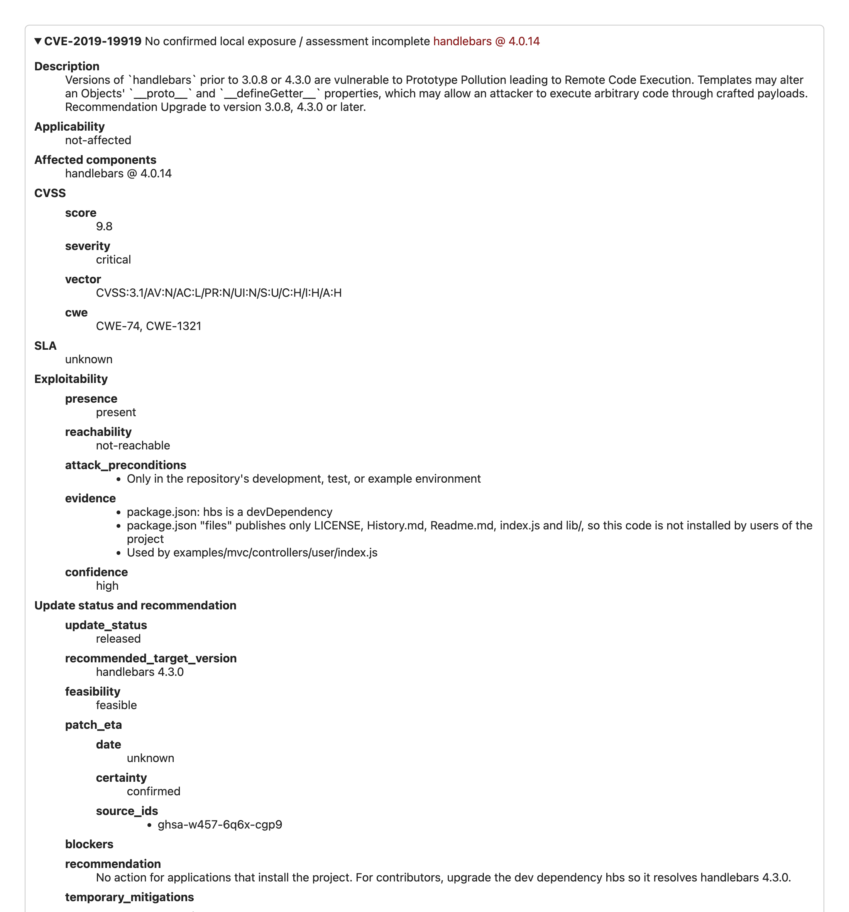

# Secdepth

Secdepth is an agent skill for investigating CVEs and other code security issues. It helps you determine whether a project is affected, trace the dependency involved, and check whether a fix can be deployed.

## Install

In Codex, invoke `$skill-installer` with repository `kobaltoxid/secdepth` and skill path `skills/secdepth`. The repository is private, so installation requires GitHub access.

To install from a local clone for Codex and Claude Code:

```sh
mkdir -p ~/.local/share
gh repo clone kobaltoxid/secdepth ~/.local/share/secdepth
~/.local/share/secdepth/scripts/install-user.sh
```

The script links the skill into `~/.agents/skills` for Codex. For Claude Code, it links into `$CLAUDE_CONFIG_DIR/skills` when `CLAUDE_CONFIG_DIR` is set, and into `~/.claude/skills` otherwise. Pass `codex` or `claude` to install for only one agent.

To add the skill to another Claude Code profile, run the script with that profile's config directory:

```sh
CLAUDE_CONFIG_DIR=~/.claude-other ~/.local/share/secdepth/scripts/install-user.sh claude
```

Start a new agent session after installation. Report rendering requires Python 3.

To run the renderer and installer tests from the repository root, use `python3 -m unittest discover -s tests`.

## Use it in a project

From the project root, invoke `$secdepth` in Codex or `/secdepth` in Claude Code. What you pass decides the mode; the skill does not ask follow-up questions:

- **Scan the project:** invoke it with no argument. It resolves the full dependency tree, including transitive, development, and build dependencies, finds every published vulnerability that matches, and analyzes how each one affects the project.
- **Check one issue:** pass a CVE, GHSA, or other advisory ID, such as `/secdepth CVE-2021-44228`. Use this to check an issue that a scanner may have missed.

Detection is deterministic. Scripts resolve the dependency tree, match every component against OSV advisories, collect reachability evidence from the code, and draft the report without a language model. The agent then reviews only the findings the scripts flag, such as conditional reachability, and writes the summary. The resolver reads npm, Cargo, Poetry, uv, pip, Go, NuGet, Gradle and Maven manifests; anything it cannot resolve is listed as a coverage gap.

Components without a package identity, such as native libraries, are matched through NVD; set `NVD_API_KEY` to raise NVD's rate limit. For air-gapped use, download OSV's exports with `skills/secdepth/scripts/osvdata.py` and pass `--osv-data` to `match.py`.

To scan a compiled artifact instead of source code, create the inventory with [binary-sca](https://github.com/kobaltoxid/binary-sca) and run the same matching, check and draft steps on it.

Include your remediation deadlines or priority rules if they should guide the report. See the [use guide](docs/use-secdepth.md) and the [inventory format](docs/inventory-format.md).


Figure 1. Scripts build the draft; the model reviews only the findings they flag. [D2 source](docs/diagrams/secdepth-flow.d2)

By default, the reports go in `security-findings/`. Use `report.json` as the authoritative record and open `report.html` to search findings, inspect dependency paths, and follow source links. See the [report output reference](docs/report-output.md).

## Example results

The screenshots below show a project scan of an older release of an open-source web framework. The scan covered 282 resolved packages, 49 runtime and 233 development-only, and reported 64 advisories. The scanned project's name is replaced with `project`.



Figure 2. The run writes only `security-findings/`, which keeps the agent's draft beside the rendered reports.



Figure 3. Sixteen runtime advisories have a deployable fix. The other 48 are development-only or do not match the scanned version.



Figure 4. CVE-2022-24999 is reachable by default because the framework parses every query string with the vulnerable qs version.



Figure 5. A critical CVSS score does not mean exposure. This handlebars advisory affects only a development dependency that the published package never installs.

## Disclaimer

Secdepth is an independent project. It is not affiliated with, endorsed by, or sponsored by the maintainers of any project it scans or any project shown in these examples. The example results are shown only to illustrate the report format.

Reports are produced by an AI agent from public advisory data and may be incomplete or wrong. Verify findings against the cited sources before acting on them. Secdepth is provided as is, without warranty of any kind.
