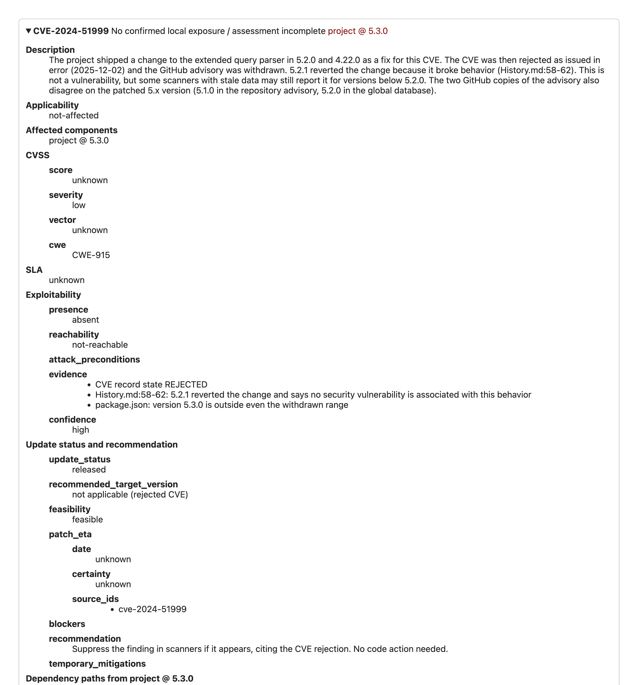

# Secdepth

Secdepth is an agent skill for investigating CVEs and other code security issues. It helps you determine whether a project is affected, trace the dependency involved, and check whether a fix can be deployed.

## Install

In Codex, invoke `$skill-installer` with repository `kobaltoxid/secdepth` and skill path `skills/secdepth`. The repository is private, so installation requires GitHub access.

To install from a local clone for Codex and Claude Code:

```sh
mkdir -p ~/.local/share
gh repo clone kobaltoxid/secdepth ~/.local/share/secdepth
~/.local/share/secdepth/scripts/install-user.sh
```

The script links the skill into `~/.agents/skills` for Codex. For Claude Code, it links into `$CLAUDE_CONFIG_DIR/skills` when `CLAUDE_CONFIG_DIR` is set, and into `~/.claude/skills` otherwise. Pass `codex` or `claude` to install for only one agent.

To add the skill to another Claude Code profile, run the script with that profile's config directory:

```sh
CLAUDE_CONFIG_DIR=~/.claude-other ~/.local/share/secdepth/scripts/install-user.sh claude
```

Start a new agent session after installation. Report rendering requires Python 3.

To run the renderer and installer tests from the repository root, use `python3 -m unittest discover -s tests`.

## Use it in a project

From the project root, invoke `$secdepth` in Codex or `/secdepth` in Claude Code. What you pass decides the mode; the skill does not ask follow-up questions:

- **Scan the project:** invoke it with no argument. It resolves the full dependency tree, including transitive, development, and build dependencies, finds every published vulnerability that matches, and analyzes how each one affects the project.
- **Check one issue:** pass a CVE, GHSA, or other advisory ID, such as `/secdepth CVE-2021-44228`. Use this to check an issue that a scanner may have missed.

Include your remediation deadlines or priority rules if they should guide the report. The agent checks primary advisories against the project's dependencies, configuration, and code. See the [use guide](docs/use-secdepth.md).


Figure 1. The agent drafts findings with citations, then the renderer writes both reports. [D2 source](docs/diagrams/secdepth-flow.d2)

By default, the reports go in `security-findings/`. Use `report.json` as the authoritative record and open `report.html` to search findings, inspect dependency paths, and follow source links. See the [report output reference](docs/report-output.md).

## Example results

The screenshots below show the output of one run. The scanned project's name is replaced with `project`.


Figure 2. The run writes only `security-findings/`, which keeps the agent's draft beside the rendered reports.


Figure 3. The report lists six advisories. None is confirmed to affect the project, so the two fix groups are empty.



Figure 4. CVE-2024-51999 was rejected as issued in error. The finding cites the rejection and recommends suppressing stale scanner results.

## Disclaimer

Secdepth is an independent project. It is not affiliated with, endorsed by, or sponsored by the maintainers of any project it scans or any project shown in these examples. The example results are shown only to illustrate the report format.

Reports are produced by an AI agent from public advisory data and may be incomplete or wrong. Verify findings against the cited sources before acting on them. Secdepth is provided as is, without warranty of any kind.
